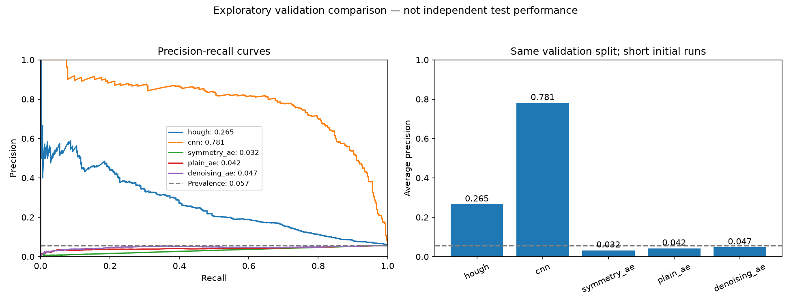

# Astrophysical Computer Vision

**Work in progress · First project contribution · COS 429 project exploration**

Can computer vision find the curved, repeated structures created by strong gravitational lensing—and can symmetry help a model recognize them?

This project connects classical image processing, supervised learning, representation learning, and a separate physics-informed experiment. The starting idea is to compare a Hough-transform approach and a CNN, then investigate autoencoders that respect image orientation and common intensity scaling. A physics-informed neural network (PINN) explores the lensing potential equation on a synthetic problem.

This first contribution establishes a reproducible data pipeline and working baselines. It records unsuccessful approaches as well as promising ones. It is an exploratory portfolio project, not a finished scientific result.

## Initial results

Classification results use the **same 6,081-image validation split**, including 346 lenses (5.69%). The supplied test set has not been scored. The CNN ran for 3 epochs; each autoencoder ran for 2, on CPU with seed 429. Validation was used for checkpoint selection, so these are preliminary results rather than independent test estimates.

| Method | Average precision ↑ | ROC-AUC ↑ |
|---|---:|---:|
| Hough features + logistic regression | 0.2655 | 0.7963 |
| Small CNN | **0.7806** | **0.9772** |
| Symmetry-aware autoencoder | 0.0318 | 0.1611 |
| Plain convolutional autoencoder | 0.0418 | 0.3567 |
| Denoising autoencoder | 0.0474 | 0.4204 |

The CNN is the strongest initial classifier. Raw maximum Hough votes are weak (AP 0.0671), while learned geometric features improve them. All three autoencoders fail as anomaly detectors with the predefined score direction: higher relative reconstruction error means more lens-like. Scores were not reversed after seeing the results. Reconstructing images well does not by itself identify lenses.



The symmetry model passes numerical checks for its constructed orientation and common-intensity equivariance, but this does not establish better detection or a new physical discovery. The PINN is evaluated separately: synthetic potential MAE **0.00949**, deflection RMSE **0.02487**, and Poisson residual RMSE **0.03859** on 4,096 held-out points. It does not infer real lens masses from this dataset.

See [full initial results](reports/initial/RESULTS.md), [machine-readable metrics](reports/initial/comparison.json), and [experimental methods](EXPERIMENTS.md). These numbers are not directly comparable with literature results on different datasets and protocols.

## Data and preprocessing

The active dataset is the **ML4SCI DeepLense observational lens/non-lens dataset**, linked in Specific Test V of the [official instructions](https://docs.google.com/document/d/10APh49fvayGoSftzO4fGXs2HP3uvYSzG-fSrq4xHL1w/edit). Download it from [Google Drive](https://drive.google.com/file/d/1doUhVoq1-c9pamZVLpvjW1YRDMkKO1Q5/view). This is the dataset used for these results, rather than the Bologna lens-finding challenge.

There are **50,055 images**, each float32 with shape **(3, 64, 64)**. Lens=1; non-lens=0. The supplied channel order is preserved; filter names are not assumed.

| Split | Lenses | Non-lenses | Total |
|---|---:|---:|---:|
| Training | 1,384 | 22,940 | 24,324 |
| Validation | 346 | 5,735 | 6,081 |
| Supplied test (unscored) | 195 | 19,455 | 19,650 |

The loader validates every array, ignores macOS metadata, checks exact pixel duplicates across splits, creates a seeded stratified validation split, and caches unchanged pixels in a memory-mapped array. Channel means and standard deviations come from training images only. Training can use right-angle rotations/reflections and balanced sampling with replacement. Validation and test retain natural class proportions with no augmentation. Without coordinates, exact-image checks cannot establish independence between sky objects.

Read [preprocessing details](docs/preprocessing.md) and [dataset provenance](DATASET.md). Raw images, caches, environments, and trained weights are excluded from this repository.

## Run it

Python **3.14** was used for the recorded run. Commands below use PowerShell from the project folder. On macOS/Linux, replace `.\.venv\Scripts\python.exe` with `.venv/bin/python`.

```powershell
python -m venv .venv
.\.venv\Scripts\python.exe -m pip install -r requirements_experiments.txt -r requirements_data.txt
.\.venv\Scripts\python.exe -B -m unittest discover -v
.\.venv\Scripts\python.exe download_data.py --output data/deeplense_observational.zip
.\.venv\Scripts\python.exe prepare.py --archive data/deeplense_observational.zip --output prepared_v1
.\.venv\Scripts\python.exe quality.py --data prepared_v1
.\.venv\Scripts\python.exe demo.py --data prepared_v1 --balanced --augment
.\.venv\Scripts\python.exe baseline.py --data prepared_v1 --output baseline_v1
.\.venv\Scripts\python.exe -u experiment_suite.py
```

The download is about 2.11 GB; the raw cache adds about 2.46 GB. Leave several additional GB for outputs. If Drive limits automated downloads, download manually from the link above. The downloader verifies the SHA-256 of the archive used for the recorded run. Tests use synthetic fixtures and do not require the dataset.

Preparation and experiment outputs must be fresh directories. The suite creates a timestamped directory under `runs/`, prints progress, and saves metrics, plots, predictions, and checkpoints. Rerunning experiments preserves earlier runs. See [EXPERIMENTS.md](EXPERIMENTS.md) for individual methods and options.

## Code map

| Files | Purpose |
|---|---|
| `download_data.py`, `prepare.py`, `data.py` | Acquisition, validation, splits, normalization, batches |
| `demo.py`, `quality.py`, `baseline.py` | Loader demonstration, quality flags, image-statistics baseline |
| `hough.py` | Foreground subtraction, edges, circular votes, geometric classifier |
| `neural_models.py`, `neural_train.py` | CNN and three autoencoder variants |
| `pinn.py` | Synthetic SIS Poisson boundary-value benchmark |
| `experiment_suite.py`, `compare_methods.py` | Sequential execution and comparison reports |
| `inspect_cnn.py`, `symmetry_probe.py` | Grad-CAM inspection and transformation checks |
| `test_*.py` | Synthetic checks for loading, geometry, symmetry, and derivatives |

## Next steps

- Run longer training and multiple seeds, with uncertainty estimates and matched compute budgets.
- Ablate orientation symmetry and amplitude normalization separately; compare with CNN orientation averaging.
- Test a supervised head or latent-space clustering instead of reconstruction error alone.
- Inspect false positives and test robustness to padding, noise, and blur.
- Freeze the final protocol before evaluating the supplied test set once.
- Extend the physics work to a calibrated forward model with source/foreground light, PSF, and noise before observational mass inference.

## Background and acknowledgments

The project draws on [Hough transforms](https://scikit-image.org/docs/stable/auto_examples/edges/plot_circular_elliptical_hough_transform.html), [group-equivariant CNNs](https://proceedings.mlr.press/v48/cohenc16.html), [autoencoder-based lens finding](https://arxiv.org/abs/1911.04320), and [differentiable lensing](https://arxiv.org/abs/1910.06157). [Common-data lens-finder comparisons](https://arxiv.org/abs/2405.12975) motivate careful evaluation. The group-averaged autoencoder is an initial implementation inspired by symmetry principles, not a reproduction of those architectures or a claim of novelty.

Thanks to ML4SCI/DeepLense and the dataset contributors. Follow the original dataset's citation and usage requirements; public availability does not establish redistribution permission. Images are not redistributed here. Code and documentation were developed with AI coding assistance and remain work in progress. A code license has not yet been selected.
